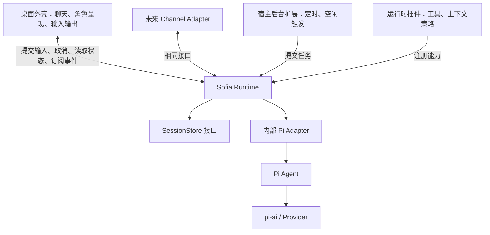

# Sofia：AI 陪伴桌宠可行性与架构讨论稿

调研开始时间：2026-09-22。职责分层、公共能力范围及下列约束已于 2026-09-24 经用户确认；具体接口签名、Hook 清单及其余标为建议的内容仍待设计。本文包含上游调研与架构讨论，不包含实现。

检索方式：按项目要求使用 Context7 CLI 的 library → docs，再核对官方文档和源码。Context7 的部分 Pi、AIRI 片段落后于当前主分支，接口细节以官方源码为准。Pi 检查到的提交为 `1a584a7a56eb5e7b4ff8ccbd46430f1533282eed`；其他 main 链接可能继续变化。

## 讨论中已确认的范围（2026-09-24 汇总确认）

- 本期“底座”指 Sofia 的无界面运行层，位于 Pi 执行引擎之上，不是重新实现 Agent Loop。
- 采用方案 B：底座定义最小插件契约，并管理已注册插件的执行与生命周期；应用层负责装配、配置和展示。下方职责表及公共能力范围已确认，具体方法签名、Hook 定义、存储和进程实现尚未定稿。
- Electron 为应用外壳。只要未彻底退出应用，运行逻辑就持续存在；关闭窗口或隐藏桌宠不影响底层运行。
- 默认插件与其他插件遵守同一公开规范；“默认”表示随应用提供，不表示有特殊内部接口。用户希望用自己编写的插件验证规范是否足够。
- 工具配置、外部工具接入、插件安装管理均属于应用层功能范围，本轮不以这些功能的开发顺序限制底座设计。
- 默认持续使用当前 Session；不引入“主 Session／副 Session”的产品概念。
- Q4 已确认：Session 的正式记录和 Run 状态由底座统一维护。插件读取允许访问的内容、返回结果或请求变更，由底座实际提交；默认插件没有绕过这一契约的特权。压缩插件提供上下文处理结果，底座负责保留原始记录并采用结果。存储实现可替换，状态归属不变。
- Q5 已确认：所有影响正式会话的对话运行请求都经底座接纳，同一个 Session 同时只有一个活动对话 Run。后台分析可以读取快照独立处理后提交结果；这不限制一个 Run 内部的工具并行。
- Q6 用户约束：底座不负责判断或自动解决插件之间的语义冲突，由用户选择兼容的插件组合。此前“完整结果策略只能选择一个插件”的统一限制尚未获接受，不作为已定设计。Hook 的调用顺序、返回值语义等必要契约，应与兼容性检测或冲突解决机制分开讨论。
- Q7 已确认：支持插件热插拔，采用空闲时整组重建插件的方式，保留应用进程与 Session；不要求只替换目标插件且保持其他实例不动。底座统一检查忙碌状态，重载期间不接纳新 Run；插件需要清理其资源。用户不接受用“第一版／MVP”作为排除能力的理由，本讨论是完整的底座职责与能力设计。
- Q8 已确认：允许插件集合部分加载成功。某个插件加载或初始化失败时报告错误，撤销该插件已登记的注册并执行已登记的清理，跳过它；其余成功插件继续运行，不因此停止整个 Agent。初始化期间的注册与清理也必须能归属到具体插件。
- Q9 已确认（2026-09-24 记录）：成功加载的插件发生运行时错误，不自动停用；报告本次错误，放弃本次失败处理的结果，下次仍可调用。工具失败返回对应错误结果。底座尽量继续其余流程；当前 Run 确实无法继续时报告失败，应用和其余会话仍可使用。不加入失败计数、熔断或自动停用／恢复机制，也不把“尽量继续”理解为无限重试失败操作。

Q6 的 Pi 源码核查：`context` 的处理器顺序执行，后者收到前者处理后的 messages；`session_before_compact` 使用通用事件返回规则，有返回结果时整体替换前一个结果，`cancel: true` 提前结束后续调用；它并不自动判断两个压缩插件是否兼容。默认资源加载器对跨扩展的同名工具报告诊断但保留扩展，运行器收集工具时先遇到的同名注册生效。这些是局部且明确的调用／注册语义，不是通用语义冲突解决。Sofia 不据此引入单选策略框架，具体 Hook 的顺序和返回值规则仍需逐一明确。来源：[ExtensionRunner](https://github.com/earendil-works/pi/blob/main/packages/coding-agent/src/core/extensions/runner.ts)、[ResourceLoader](https://github.com/earendil-works/pi/blob/main/packages/coding-agent/src/core/resource-loader.ts)。

用户于 2026-09-24 确认下方职责分层和公共能力范围准确表达其意图，本轮 grilling 完成。后续设计以这些约定为依据，不将所有实现细节逐一变成确认题；本次不启动实现。

### 已确认的职责与公共能力

以下职责与公共能力范围已经确认；具体方法签名、Hook 清单及数据结构尚未定稿。

| 归属 | 职责 |
| --- | --- |
| Pi 执行引擎 | 模型／工具循环及底层流式执行；不由 Sofia 重写循环。 |
| Sofia 底座 | Session 记录与恢复语义、Run 接纳及同 Session 串行执行、取消、事件与状态读取、工具／Hook 注册和调用、插件生命周期与空闲时整组重载、可定位的错误结果。 |
| 功能插件 | 具体工具、人格与上下文贡献、压缩和记忆策略、做梦等主动行为的策略。通过底座公开接口参与，不直接写底座内部状态。 |
| 应用层 | Electron 生命周期、窗口与 Live2D 呈现、交互与输入输出接入、配置与凭据、插件安装／选择、资源和具体适配器装配、错误展示。 |

底座对应用的接口宜按少数操作组织：会话创建／打开／读取；提交输入；取消 Run；读取当前状态并订阅事件；空闲时重新装配插件集合；应用退出时关闭运行层。输入来源可以是用户、Channel 或插件，但共享运行接纳入口。

底座对插件提供注册工具、参与明确 Hook、观察事件、读取允许的会话快照、通过统一入口提交运行请求及登记清理等能力。需要保存的交流事实由底座提交；插件如何持久化自身领域数据仍属于具体插件设计，不在底座中提前建立统一记忆框架。

常规运行流程：接纳输入并按 Session 调度 → 保存输入并准备上下文 → 调用 Pi 执行引擎 → 在执行期间通过 Hook 接入插件、保存定稿消息和工具结果并发布事件 → 标记 Run 结束并释放执行权。插件失败时按已确认的尽量继续原则处理；无法维持有效运行状态时，当前 Run 明确失败，不伪造成功结果。

## 判断

可行。推荐方向是：以 Pi 的 Agent 执行器和 pi-ai 为依赖，在其上提供一个小型、无 UI 的 Sofia Runtime；外壳、输入输出和后台扩展通过明确接口接入。首要目标是本机单人陪伴；多通道可以后加。

简单应体现为职责明确、状态归属单一、接口少。会话写入顺序、取消后的执行收束、运行完成的判断，需要由底座统一负责。记忆算法、人格配置、具体工具、语音和角色呈现可以变化。

## 上游事实与复用选择

| 项目 | 已核实的事实 | 对 Sofia 的启发／建议 |
| --- | --- | --- |
| Pi Agent | Agent 有模型／工具循环、流式事件、上下文转换和取消能力。Pi 的 turn 表示一次模型调用及其请求的工具执行。 | 优先复用 Agent 类；Sofia 维护自己的会话及输入调度语义。 |
| Pi coding-agent | SDK 提供 AgentSession、SessionManager、扩展加载、压缩及完整应用运行逻辑，可嵌入自定义 UI。 | 它是可行的快速组合方案，但会引入更多 coding/workspace/TUI 相关概念。当前目标更适合参考其设计，不直接继承整层。 |
| pi-ai | 提供多 Provider 调用、模型目录及自定义兼容端点。 | 复用其 Provider 能力；各模型能力仍需分别判断。 |
| AIRI | 当前 core-agent 通过 ports 接收应用的持久化和 UI；音频编排有独立模块。 | 借鉴接口和装配方式；其核心和角色包存在私有 workspace 依赖，不应假设可直接抽出当独立 SDK。 |
| OpenClaw | 宿主负责会话解析、同 Session 的 Run 串行化、事件转发与持久化；普通回复路由由宿主确定。 | Channel 和 Session 分开，运行调度放在模型循环外。 |
| Hermes | Gateway 平台 Adapter 统一输入；定时任务在独立上下文执行，执行与投递分开。 | 主动行为由外围触发；做梦适合独立后台上下文。 |

来源：[Pi Agent README](https://github.com/earendil-works/pi/blob/main/packages/agent/README.md)、[Pi SDK](https://github.com/earendil-works/pi/blob/main/packages/coding-agent/docs/sdk.md)、[Pi 扩展](https://github.com/earendil-works/pi/blob/main/packages/coding-agent/docs/extensions.md)、[pi-ai](https://github.com/earendil-works/pi/blob/main/packages/ai/README.md)、[AIRI core-agent](https://github.com/moeru-ai/airi/blob/main/packages/core-agent/README.md)、[AIRI audio pipelines](https://github.com/moeru-ai/airi/blob/main/packages/pipelines-audio/README.md)、[AIRI package](https://github.com/moeru-ai/airi/blob/main/packages/core-agent/package.json)、[OpenClaw Agent loop](https://docs.openclaw.ai/concepts/agent-loop)、[Channel routing](https://docs.openclaw.ai/channels/channel-routing)、[Hermes Gateway](https://github.com/NousResearch/hermes-agent/blob/main/website/docs/developer-guide/gateway-internals.md)、[Hermes Cron](https://github.com/NousResearch/hermes-agent/blob/main/website/docs/developer-guide/cron-internals.md)。

版本细节：原 `badlogic/pi-mono` 已重定向至 `earendil-works/pi`，当前主分支包名采用 `@earendil-works/*`。整个 pi-agent-core 包已经包含 Session/Harness 导出，不能再笼统称其“没有 Session”。这里推荐的 Agent 类本身仍是执行态管理；它的 `sessionId` 用于 Provider 缓存，不自动代表 Sofia 的持久会话。新版 Session/Harness 应作为实现候选单独验证，而非在本次讨论中默认采用。来源：[package.json](https://github.com/earendil-works/pi/blob/1a584a7a56eb5e7b4ff8ccbd46430f1533282eed/packages/agent/package.json)、[Agent 源码](https://github.com/earendil-works/pi/blob/1a584a7a56eb5e7b4ff8ccbd46430f1533282eed/packages/agent/src/agent.ts)、[导出](https://github.com/earendil-works/pi/blob/1a584a7a56eb5e7b4ff8ccbd46430f1533282eed/packages/agent/src/index.ts)。

Session/Harness 已在 0.84.0 提升到默认导出，但该版本明确称其为 scaffold，检查到的当前代码仍有未实现方法（如 watchSession）。这不代表普通 prompt/resume 不可用，也不能把整个模块称为实验接口。其 Session 存储实现可作为复用候选，完整 Harness 是否适合应按所需能力评估。选择薄宿主层的代价是自行维护会话恢复和插件生命周期；若更重视快速复用 Pi 现成扩展，则 coding-agent SDK 值得重新比较。来源：[变更日志](https://github.com/earendil-works/pi/blob/1a584a7a56eb5e7b4ff8ccbd46430f1533282eed/packages/agent/CHANGELOG.md)、[Harness 当前实现](https://github.com/earendil-works/pi/blob/1a584a7a56eb5e7b4ff8ccbd46430f1533282eed/packages/agent/src/harness/runtime/harness.ts)。

## 建议的模块关系

这是运行关系图，不是源码 import 方向。存储实现、Pi Adapter、插件与外壳由最外层启动代码装配。模块可以先放在同一仓库、同一进程中；不必先拆成大量包或常驻网络服务。

Runtime 对调用方只需要少数能力：提交输入、取消运行、读取会话／当前运行快照、订阅增量事件。此处是概念接口，不是已经选定的方法签名。读取快照不可省略，否则 UI 重连或重新打开后只有未来事件，无法重建状态。

依赖倒置优先用在真实会变化的位置：Runtime 接收存储实现；UI 依赖 Sofia 的输入输出契约；Pi 类型被收在内部 Adapter。可以直接用工厂参数注入，无需 DI 容器。当前没有支持任意 Agent 引擎的需求，因此不以此扩大抽象范围，也不逐个镜像 Pi 的所有方法。

## 建议术语

以下定义待用户讨论确认，暂不写入 CONTEXT.md。

| 术语 | 建议含义 |
| --- | --- |
| Session | 一条可恢复、持续存在的交流上下文；不是窗口、进程或 Provider 的连接。 |
| Run | 宿主接纳并开始处理一次输入后，到执行及必要持久化收束为止的过程；具有完成、失败或取消等结果。 |
| Turn | 沿用 Pi：一次模型响应及其请求的工具执行；一个 Run 可含多个 Turn。 |
| Message | 会话中的一条消息；与 Turn 不一一对应。 |
| Origin / Reply target | 输入来自哪里、输出应送到哪里；不决定 Session 身份。 |

例如“帮我看看天气，然后提醒我带伞”：Session A 中启动 Run 1；Turn 1 模型请求天气工具并取得结果；Turn 2 模型给出答复；Run 1 结束。接下来的闲聊启动 Run 2，仍属于 Session A。

2026-09-23 澄清：这里不引入“主 Session／副 Session”两种类型，也不要求会话之间有主从关系。此前“长期主 Session”的说法容易造成误解，应改为“默认持续使用当前 Session”。用户希望体验上始终延续同一段交流；建议启动时恢复当前 Session，仅在用户主动新建时创建另一条独立 Session。恢复可以指重启后加载同一 Session，也可以指用户重新打开过去保存的 Session；都不是复制出新 Session。“内部支持”只表示 Runtime 有相关操作，不表示它会自行切换或切碎对话。上下文压缩不要求改变 sessionId。长期记忆可以跨 Session；换一个 Session 不应自动意味着角色忘掉与你的关系。后台做梦的隔离上下文也不需要被称为“副 Session”。

同日核实参照项目：OpenClaw 当前默认 `session.reset.mode: "none"`，保持 sessionId，用压缩管理上下文；每日／空闲重置为可选配置。Hermes 当前 Gateway 不因空闲或跨日重置，使用 `/new`、`/reset` 显式开始新对话；该结论不能直接推广到 CLI 每次普通启动。Hermes 内部还支持压缩后的 continuation session lineage，因此逻辑对话持续不保证每个内部存储 ID 永远相同。Sofia 的建议仍是保持产品 Session 身份，压缩只更新它使用的上下文。来源：[OpenClaw 生命周期](https://docs.openclaw.ai/concepts/session#session-lifecycle)、[Hermes Gateway 连续性](https://github.com/NousResearch/hermes-agent/blob/main/website/docs/user-guide/messaging/index.md#session-continuity)、[Hermes 压缩 lineage](https://github.com/NousResearch/hermes-agent/blob/main/website/docs/user-guide/sessions.md#auto-lineage-on-compression)。

同 Session 只允许一个活动写入 Run。底座统一管理输入接纳和调度，避免同时把相同输入放入两套队列；新输入的排队、steering 或取消处理是尚需明确的契约。steering 必须关联到正在执行的 Run。当前 Pi 的 steering 在当前 Turn 工具完成后注入，不能当作即时语音打断。来源：[Pi types](https://github.com/earendil-works/pi/blob/main/packages/agent/src/types.ts)。

## 插件应分为几种扩展方式

用户希望扩展的能力都可以支持，但它们不应共享一个“任意修改所有状态”的通用回调。

| 扩展 | 建议接入方式 | 底座仍负责什么 |
| --- | --- | --- |
| Tools | 启动时注册模型可调用的工具 | 执行关联、取消传播、结果归档 |
| 人格／记忆检索 | 在模型请求前，按顺序返回上下文贡献或转换结果 | 上下文组成顺序、预算和历史完整性 |
| 上下文压缩 | 在请求前或安全提交点提供压缩结果 | 保存原始历史、摘要覆盖范围及采用哪个版本 |
| 做梦／反思 | 宿主后台扩展读取快照，独立处理后提交提议 | 防止过期结果覆盖新状态；协调前台活动 |
| 语音 | 输入／输出管线：识别产生普通输入，合成消费可播报输出 | Run 关联及取消语义 |
| Live2D | 外壳侧呈现扩展，消费角色状态／表达语义 | 提供与具体模型参数无关的事件 |
| 多 Channel | 外围 Adapter 转换输入并投递输出 | 会话归属和确定性回复路由 |

最少需要区分：能力注册、会影响执行的等待式 Hook、只读观察事件。Hook 按配置顺序执行，返回结果由 Runtime 应用；UI、日志和音频等观察者不应阻塞模型执行。存储提交属于 Runtime 的必要步骤，不能混在普通观察者中。当前 Pi Agent 的 subscribe 会等待异步订阅者，因此外围慢消费者应由 Adapter 隔离，不能直接把 TTS 播放挂进去等待。来源：[Pi Agent 事件语义](https://github.com/earendil-works/pi/blob/main/packages/agent/README.md)。

默认插件与其他插件统一遵守公开契约，不能按来源分成具有不同权限的两套扩展机制。具体打包、发现、安装及管理方式属于应用层，后续讨论；本期先确定注册、初始化、执行和退出清理的契约。固定装配顺序、重复工具名处理及配置的表达方式仍为待确认建议。

### 热插拔核查与方案（2026-09-23）

热插拔是用户明确要求，不以实施阶段排除。应区分插件代码重载、工具可见集合更新、MCP 连接变化，不能把其中一项支持推导为所有插件都能任意时刻被替换。

- **Pi**：核查提交 `a328aa89ad6e6dc5c5628ff896769532ed3d29df`。交互入口在响应或压缩中拒绝 `/reload`；SDK 的 `AgentSession.reload()` 本身没有同样的忙碌保护。重载执行旧 shutdown、失效旧扩展 API、重读资源、重建运行器和新 start，保留 SessionManager。受管事件订阅自动撤销；插件自己创建的 timer、socket、watcher 需自行清理。单个新扩展加载失败会报告错误、继续其他扩展，没有恢复整套旧运行器的事务回滚。来源：[交互入口](https://github.com/earendil-works/pi/blob/a328aa89ad6e6dc5c5628ff896769532ed3d29df/packages/coding-agent/src/modes/interactive/interactive-mode.ts#L6171)、[重载生命周期](https://github.com/earendil-works/pi/blob/a328aa89ad6e6dc5c5628ff896769532ed3d29df/packages/coding-agent/src/core/agent-session.ts#L3291)、[扩展加载及清理](https://github.com/earendil-works/pi/blob/a328aa89ad6e6dc5c5628ff896769532ed3d29df/packages/coding-agent/src/core/extensions/loader.ts)。
- **Claude Code**：当前支持 `/reload-plugins`；关闭插件管理菜单会应用变更，若仍在响应则等响应结束。其插件主要组合 skills、agents、hooks 和 MCP/LSP，不能等同于 Pi 的通用进程内 JS 扩展。官方还列有后台 monitors 及非交互模式插件 MCP 不能立即切换的限制。来源：[生效时机](https://code.claude.com/docs/en/discover-plugins#apply-plugin-changes-without-restarting)、[插件结构与限制](https://code.claude.com/docs/en/plugins-reference)。
- **OpenCode V2**：支持受监视配置变更触发重载，setup 可返回 cleanup；服务不重启，运行中的会话在下一个 step 边界使用新服务。模型请求有工具定义和执行器快照，因此比只在空闲时切换涉及更多并存语义。这里指 V2，不能与 V1 的实例 dispose/reinit 路径混写。来源：[V2 reload](https://opencode.ai/v2/docs/cli/commands/#reload)、[插件生命周期和工具契约](https://opencode.ai/v2/docs/build/plugins)、[V2 supervisor](https://github.com/anomalyco/opencode/blob/v2/packages/core/src/plugin/supervisor.ts)。

对 Sofia 的建议：采用空闲时热重载，应用进程与 Session 均保留。底座统一提供替换插件集合的操作；若有活动 Run 或正在使用插件的工作，则拒绝本次修改并返回 busy。检查空闲与进入重载应由底座作为一个不可穿插的操作完成；重载期间暂不接纳新 Run，避免界面先检查空闲后又与新输入竞争。

在可重载时，停止旧插件、等待清理、撤销旧工具及 Hook 注册、失效旧调用入口，再加载并初始化新插件集合，完成后恢复接纳输入。插件的后台任务和外部资源必须遵守清理契约，不能只凭用户 Run 结束就认为所有代码都已停止。模块加载器也需要支持重新导入更新代码，不能只对同一路径再次调用普通 import 并假设缓存消失。

用户已选择整组重载：实现用户层面的增加、移除与更新，并接受未修改插件的内存状态也重新建立；Session 和持久化数据独立保留。无需保证新旧插件实例并存或其他插件实例不中断。注册与资源仍需有明确归属，以便完整清理和报告错误。新集合允许部分成功；单个插件加载失败时撤销其已登记的注册、执行已登记的清理并报告错误，其余插件继续运行。未选择整组失败或自动恢复旧集合的方案。

## 状态、记忆与恢复

建议明确区分三种数据：原始交流记录、这次模型请求的上下文、跨会话的长期记忆。压缩改变本次及后续的上下文投影，保留原始记录；长期记忆提取事实和关系信息；做梦处理的是记忆材料，不自动产生一条对用户说过的话。

SessionStore 是持久事实来源，Pi 内存状态是执行态。保存定稿消息、工具结果和 Run 状态；流式 token、音频帧、动画帧默认不逐个持久化。开始执行输入前先记录接纳事实，完成后再发布已收束状态。崩溃恢复时把未结束 Run 标记为 interrupted，不自动重放可能有副作用的工具；模型上下文投影要妥善处理没有结果的工具调用。

取消请求与执行结束是两个时刻。UI 可以立即停止展示／播放；Runtime 仍需等待当前执行收束后释放该 Session。事件带 runId，过期事件不覆盖新运行的显示。AbortSignal 是协作式取消，不能保证强行终止任意插件代码；插件需要遵守取消契约，强制隔离则需要另外的进程机制。

后台做梦读取的快照带 revision，返回提议而非直接改聊天历史。提交时若基础版本已经过期，可以丢弃并稍后重算；是否需要合并，应由实际记忆机制的要求决定。慢任务不放在同步结束 Hook 中等待，也不复用正在聊天的 Agent 实例。

## 外壳、Provider 与主动行为

外壳只理解 Sofia 的消息、Run 状态和表达语义，例如 thinking、speaking、expression；不理解 Pi 内部对象。Live2D 模型参数在呈现 Adapter 中映射。语音需要自己的采集、转写、分句、合成、播放与打断流程，Agent Run 完成不代表语音已经播完。生成、持久化和用户实际看到／听到也是不同事实。

pi-ai 能承担文本／工具模型的多 Provider 接入；不同模型的图像、工具、思考和上下文能力不完全一致。原生实时语音不能直接假设为一次文本模型替换，届时需要专门的持续会话 Adapter。AIRI 当前也明确将 Realtime 的连续输入、打断与 Session ownership 列为独立设计问题。来源：[pi-ai](https://github.com/earendil-works/pi/blob/main/packages/ai/README.md)、[AIRI Realtime 限制](https://github.com/moeru-ai/airi/blob/main/packages/core-agent/README.md)。

主动发言由定时／空闲／外部事件提出一次输入，Runtime 决定接纳与执行；Agent Loop 不需要一直空转。真正展示的主动发言应进入陪伴交流记录，内部候选或被抑制的内容不能冒充已交流内容。用户已确认：宿主运行期间，关闭窗口或隐藏桌宠不停止后台逻辑；彻底退出应用才停止。具体进程部署尚未决定。

多 Channel 只需保留 origin/reply target 元数据及统一输入输出接口。未来可以把桌面与手机通道映射到同一当前 Session，回复仍返回来源通道。无需提前引入多用户身份系统、分布式队列或复杂 Gateway。

## 建议验证顺序与尚未确定的选择

最小验证路径：无图形界面的文字会话 → 持久化及重启恢复 → 一个工具插件和一个上下文插件 → 取消与排队 → 简单桌面外壳。确认这些链路后，按体验需求接入语音、Live2D、记忆策略和主动行为。

上线具体功能前，要检查插件失败、取消后的迟到结果、崩溃后的工具记录、过期后台提议和外壳重连；本次只有调研，没有运行实现或测试。

用户已澄清希望交流体验持续，且关窗不停止运行。当前集中讨论无界面底座的职责与插件契约；文字与实时语音的优先级、目标系统及应用管理页面不作为本轮前置问题。产品背景为一个使用者、一个角色、默认持续使用当前 Session。
